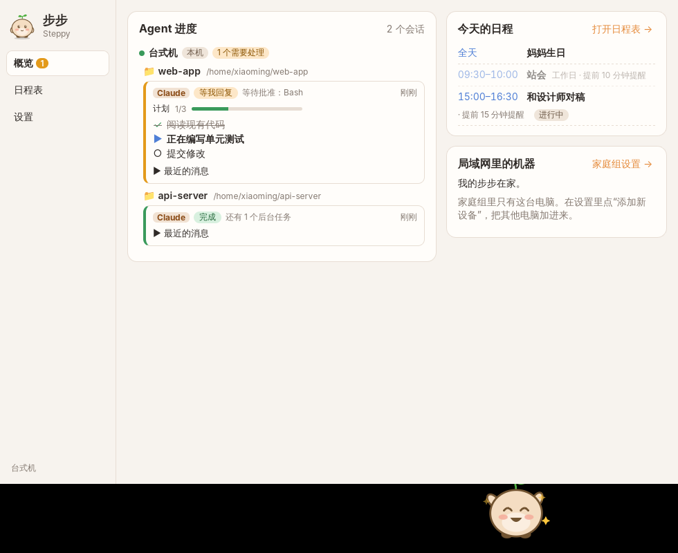

# 步步 Steppy

步步（Steppy）是一只原创的桌面宠物：一个头顶小芽的圆滚滚团子，平时沿着任务栏 / 屏幕底边溜达。它有两个本事：

1. **盯着 Agent 干活**：Claude Code 和 Codex CLI 在跑、在等你回复或批准、完成了、出错了，它都会做出对应动作并在头上冒气泡；点它打开面板，能看到每个会话的计划清单和完成情况。
2. **管日程**：日视图 / 周视图，支持全天事件、重复（每天、每周、工作日）、提前提醒和稍后提醒，到点时它会抱着日历提醒你；支持 .ics 导入导出。

家里的几台电脑装上步步后可以组成一个**家庭组**：任何一台电脑上的 Agent 进度和日程，所有电脑都能看到；宠物还能从一台电脑的屏幕边缘走出去，出现在另一台电脑的屏幕上“串门”。




> 仓库名 `step-by-step` 是历史遗留；应用名是 **步步 Steppy**（安装包文件名为 `Steppy`）。

---

## 目录

- [下载和安装](#下载和安装)
- [第一次安装需要做的事](#第一次安装需要做的事)
- [日常使用](#日常使用)
- [Claude Code 接入细节](#claude-code-接入细节)
- [Codex CLI 接入细节](#codex-cli-接入细节)
- [局域网联机与安全设计](#局域网联机与安全设计)
- [日程同步的合并规则](#日程同步的合并规则)
- [串门协议：同一时刻只在一台机器上](#串门协议同一时刻只在一台机器上)
- [平台支持与已知限制](#平台支持与已知限制)
- [数据存放位置](#数据存放位置)
- [开发与测试](#开发与测试)
- [真机手动验收清单](#真机手动验收清单)

---

## 下载和安装

每次推送都会在 GitHub Actions 里构建三个平台的安装包。打开仓库的 **Actions → CI → 最近一次成功的运行**，在页面底部的 *Artifacts* 里下载：

| 平台 | 产物 | 说明 |
| --- | --- | --- |
| Windows | `steppy-Windows` 里的 `Steppy_1.0.0_x64-setup.exe`（NSIS）和 `Steppy_1.0.0_x64_zh-CN.msi` | 推荐 NSIS 安装包，按当前用户安装，不需要管理员权限 |
| macOS | `steppy-macOS` 里的 `.dmg` | Apple Silicon |
| Linux | `steppy-Linux` 里的 `.deb` 和 `.AppImage` | |

安装包没有代码签名：

- Windows 首次运行可能出现 SmartScreen“已保护你的电脑”，点“更多信息 → 仍要运行”。
- macOS 首次打开请在 Finder 里右键 → 打开（或在“系统设置 → 隐私与安全性”里允许）。

## 第一次安装需要做的事

1. **Windows 防火墙放行**：第一次启动时 Windows 会弹出“Windows 安全中心警报”，请勾选 **专用网络** 并点“允许访问”。步步需要监听一个 TCP 端口（默认 47900）和使用 mDNS（UDP 5353）来发现、连接同一局域网里的其他电脑。如果当时点了取消，可以在“Windows 安全中心 → 防火墙和网络保护 → 允许应用通过防火墙”里给 `steppy.exe` 勾上“专用”。同时确认你的网络在 Windows 里被设为“专用网络”而不是“公用网络”。
2. **接入 Claude / Codex**：打开面板 → 设置 → “接入 Claude / Codex”，分别点“一键接入”。会自动备份原配置（`settings.json.steppy-backup-<时间>`、`config.toml.steppy-backup-<时间>`），只追加步步自己的条目。已经开着的 Claude Code 会话需要重启后才会使用新的 hooks。
3. **组建家庭组**：在第一台电脑上点“创建家庭组”；在这台电脑上点“添加新设备”，屏幕上会显示 6 位配对码；在新电脑上的“加入已有的家庭组”里输入这个配对码。每台新电脑重复一次。
4. **摆放位置**：在“设置 → 家庭组 → 摆放位置”里，按照桌上真实的位置从左到右排好各台电脑（就像排列多块显示器）。宠物走出屏幕左 / 右边缘时，会去相邻那台电脑。
5. （可选）**开机自启**：托盘菜单或设置里勾选“开机自启”。
6. （可选）**系统通知 / 免打扰**：设置 → 提醒与免打扰。

> 如果你的路由器隔离了组播（mDNS 发现不到其他电脑），可以在“设置 → 家庭组 → 网络”里手动填写对方的 IP 和端口（例如 `192.168.1.20:47900`），配对和连接都会走这个地址。

## 日常使用

- **宠物**：自己在任务栏上沿着屏幕底边散步、发呆、犯困睡觉；支持多显示器（会走到另一块屏上，沿着那块屏的任务栏走）和不同的 DPI 缩放。只有宠物本身和气泡能点到，其他区域鼠标会穿透到下面的窗口。
  - 单击：打开面板。
  - 按住拖动：拎起来放到别处，松手后会落到最近的地面上；拖到屏幕最左 / 最右边缘松手，并且那一侧有在线的邻居电脑，它就直接去串门。
- **动作**：待机、走路、睡觉、开心（Agent 完成）、举手（Agent 在等你回复或批准）、着急（出错）、看日历（日程提醒），以及被拎起来、下落。
- **气泡**：提醒都以头上的气泡出现；日程提醒的气泡上有“5 分钟后 / 15 分钟后 / 知道了”。设置里可以同时发系统通知，可以设免打扰时段（可跨午夜）。宠物出门串门或被隐藏时，提醒改用系统通知。
- **托盘菜单**：显示 / 隐藏宠物、打开面板、日程表、设置、召回宠物、开机自启、退出。关闭面板窗口只是隐藏，程序继续在托盘里运行。
- **面板 → 概览**分三块：
  1. **Agent 进度**：按 机器 → 项目目录 → 会话 分组，显示 Claude / Codex、状态（运行中 / 等我回复 / 完成 / 出错，另有空闲和已结束）、状态说明（比如“等待批准：Bash”）、计划清单及每一项的完成情况、最近更新时间。
  2. **今天的日程**。
  3. **局域网里的机器**：各台电脑是否在线、各有几个 Agent 在跑；我的宠物在哪（可以召回，或让它去左 / 右邻居家串门）；正在本机做客的别人家宠物（可以送它回家）。
- **节日主题**：春节（除夕到初七）、元宵、清明、端午、七夕、中秋、重阳等农历节日，以及元旦、情人节、劳动节、儿童节、国庆、万圣节、圣诞，宠物会自动换上节日外观，当天冒一个祝福气泡（每个节日每年只说一次，免打扰时段内不说）。还可以添加自定义纪念日（比如家人生日）。设置里可以关闭，也可以“预览”任意节日。现在用的是程序画的占位图形，正式美术资源按 [docs/themes.md](docs/themes.md) 放进 `public/themes/` 即可替换，不用改代码。
- **日程表**：日 / 周视图，双击空白时段新建，点击日程编辑或删除。顶部可以导入 / 导出 .ics。修改重复日程会作用于整个系列。

## Claude Code 接入细节

依据：<https://code.claude.com/docs/en/hooks>（2026-11 版本；`docs.claude.com` 的 hooks 文档现在跳转到这里）以及工具参考 <https://code.claude.com/docs/en/tools-reference>。

“一键接入”会在 `~/.claude/settings.json`（如果设置了 `CLAUDE_CONFIG_DIR` 则用其中的 `settings.json`）的 `hooks` 里，为下面每个事件**追加**一个 matcher 组，不碰你已有的 hooks：

| 事件 | 用途 |
| --- | --- |
| `SessionStart` | 会话开始 / 恢复（`source` 为 resume / compact 时会读 transcript 补全计划） |
| `UserPromptSubmit` | 用户发了新消息 → 运行中 |
| `PostToolUse` | 工具执行完 → 运行中（批准后恢复运行）；`TodoWrite` / `TaskCreate` / `TaskUpdate` / `ExitPlanMode` 时更新计划 |
| `TaskCreated` / `TaskCompleted` | 任务工具的任务创建 / 完成 |
| `PermissionRequest` | 要求批准 → 等我回复（立刻触发，不必等 `Notification` 的 6 秒） |
| `Notification` | `permission_prompt` / `elicitation_dialog` / `elicitation_url_dialog` / `agent_needs_input` → 等我回复 |
| `Stop` | 一轮结束 → 完成 |
| `StopFailure` | 因 API 错误结束（`rate_limit` 等）→ 出错 |
| `SessionEnd` | 会话结束 |

当前版本的 Claude Code 默认用 `TaskCreate` / `TaskUpdate` 等任务工具代替 `TodoWrite`（设置 `CLAUDE_CODE_ENABLE_TASKS=0` 才用 `TodoWrite`），并且在较新的模型上默认不提供这些工具（可用 `CLAUDE_CODE_ENABLE_TODO_TOOLS=1` 打开）。两种工具步步都能解析；当 Claude 不写计划时，面板上就只有状态没有计划清单。

每个 hook 是这样的（exec 形式，路径里有空格、Windows 上没有 Git Bash 都没问题）：

```json
{
  "type": "command",
  "command": "C:\\Users\\你\\AppData\\Local\\steppy\\bin\\steppy-hook.exe",
  "args": ["claude", "--endpoint", "C:\\Users\\你\\AppData\\Local\\steppy\\endpoint.json"],
  "timeout": 5
}
```

- `steppy-hook` 是一个约 400 KB 的独立小程序：读 stdin 的 JSON，POST 给宠物在 `127.0.0.1` 上的接口，带 `Authorization: Bearer <token>`。token 在第一次运行时随机生成，只保存在数据目录里（Unix 上权限 0600），不会出现在命令行参数里。
- 宠物没在运行时：endpoint.json 在程序退出时会被删除，hook 发现文件不存在立刻退出；即使程序是崩溃退出的，连接 127.0.0.1 也会被立即拒绝（最多等 300 毫秒）。hook 永远以退出码 0 结束、不向 stdout 输出任何东西，不会影响 Claude 的行为。
- `SessionEnd` 没有设置 `timeout`，以免拉长 Claude 退出时的 1.5 秒预算。
- hook 程序会被复制到数据目录的 `bin/` 下再引用，这样升级或 AppImage 路径变化后配置仍然有效。
- “撤销接入”只删除命令是 `steppy-hook` 的条目，删除因此变空的 matcher 组和事件键，其余内容原样保留。**卸载步步前请先撤销接入**，否则 Claude 会因为找不到 hook 程序而在会话里显示 hook 错误。

## Codex CLI 接入细节

依据：openai/codex 仓库 2026-11 的源码（`codex-rs/hooks/src/legacy_notify.rs`、`codex-rs/history/src/rollout_payload.rs`、`codex-rs/rollout/src/policy.rs`、`codex-rs/protocol/src/protocol.rs`、`codex-rs/protocol/src/plan_tool.rs`）。

- **notify**：Codex 在每一轮完成后执行 `~/.codex/config.toml`（或 `$CODEX_HOME/config.toml`）里的 `notify` 命令，并把 `{"type":"agent-turn-complete","thread-id",...}` 作为最后一个参数追加。`notify` 只能有一个命令，所以如果你已经配置了自己的 notify，步步会把它串联在后面而不是覆盖：

  ```toml
  notify = ["…/steppy-hook", "codex-notify", "--endpoint", "…/endpoint.json", "--then", "notify-send", "Codex"]
  ```

  步步先把事件发给宠物，再原样执行 `--then` 之后的命令（同样追加 JSON）。撤销时还原成 `notify = ["notify-send", "Codex"]`；原来没有 notify 就删除这个键。文件里的注释和其他配置都保留。
- **进度和计划**：步步每 1.5 秒增量读取 `~/.codex/sessions/YYYY/MM/DD/rollout-*.jsonl`（只读最近两天的目录、最近 12 小时修改过的文件，按字节偏移续读，半行留到下次）：
  - `session_meta` → 会话 id、项目目录；子 Agent / 内部会话不显示。
  - `event_msg` 的 `task_started`（`turn_started`）→ 运行中；`user_message` / `agent_message` → 最近消息；`task_complete`（`turn_complete`）→ 完成，带 `error` 时为出错；`turn_aborted` → 已中断 / 出错。
  - `plan_update` 事件**不会**写入 rollout，所以计划来自 `response_item` 里 `name == "update_plan"` 的 `function_call`，`arguments` 是 `{"explanation"?, "plan":[{"step","status"}]}` 的 JSON 字符串。
  - 压缩成 `.jsonl.zst` 的冷数据不读（那些会话早已结束）。
- **限制**：Codex 的审批请求（`exec_approval_request` 等）不写入 rollout，notify 也只在一轮完成时触发，所以**Codex 会话无法显示“等我批准”**，只会显示运行中 / 完成 / 出错。一轮完成后 Codex 在等你的下一条消息，此时状态为“完成”。

## 局域网联机与安全设计

代码在 `crates/steppy-core/src/net/`，都有单元测试。

- **发现**：mDNS/DNS-SD 服务 `_steppy._tcp.local.`。实例名和主机名是随机的 node id（公钥哈希的前 16 个十六进制字符），TXT 里只有 `v=1`（协议版本）、`m=0/1`（是否在家庭组里）、`p=0/1`（是否正在显示配对码）。**不包含**机器名、用户名、项目或任何任务信息。
- **身份**：每台机器第一次运行时生成 Ed25519 身份密钥。
- **配对（PAKE）**：已入组的机器点“添加新设备”后显示 6 位配对码（5 分钟有效）。新机器输入配对码后与它运行 **SPAKE2**（Ed25519 群），双方用 HMAC 确认得到了相同的密钥（即配对码一致），然后用由该密钥派生的 ChaCha20-Poly1305 密钥交换：新机器的成员信息（含公钥）→ 已入组机器；家庭组状态（成员名单、组密钥）→ 新机器。旁听者拿不到组密钥，也无法离线暴力破解配对码；在线猜测每次连接只能猜一个，**错 5 次配对码作废**。
- **会话握手**：两台成员机器连接时做三次握手，交换 X25519 临时公钥和随机数；双方用身份私钥对握手记录签名（证明“我是名单里的这台机器”），并用组密钥派生的 HMAC 证明“我持有当前组密钥”。会话密钥 = HKDF(盐 = 组密钥, 输入 = X25519 共享秘密, 信息 = 握手记录)，两个方向各一把。
- **每条消息加密 + 鉴权 + 防重放**：ChaCha20-Poly1305 AEAD，帧格式 `[8 字节计数器][密文+标签]`，nonce 由计数器构成，计数器同时作为附加认证数据；接收方要求计数器严格等于期望值，篡改、重放、乱序都会被拒绝并断开连接。每次连接的临时密钥都不同，旧连接的帧无法在新连接里重放。
- **没配对的机器什么都看不到**：握手失败时直接断开、不回复任何内容；未入组的机器只能看到 mDNS 里的随机 id。
- **踢出成员**：被踢的机器先收到通知并被断开，成员名单里标记移除（墓碑，不能用同一身份重新加入），然后**生成新的组密钥（epoch + 1）**，只发给剩下的成员。被踢的机器既没有新密钥，也不在名单里，无法再握手（它也无法冒充别的成员，因为需要那台机器的身份私钥）。离线期间错过换密钥的成员，回来后可以用旧 epoch 握手一次以拿到新状态，然后自动用新密钥重连；两台机器同时踢人造成的同 epoch 冲突会被确定性地合并并再换一次密钥。
- **隐私**：同步给其他机器的默认只有 Agent 状态、状态说明、计划条目、项目目录和时间。消息正文、提示词、会话标题默认不发出去；在“设置 → 家庭组 → 成员”里可以按机器单独打开“把消息正文和提示词同步给它”。
- **断线重连**：成员之间自动重连（mDNS 地址、上次成功的地址、手动地址），连上后双方互发完整快照（Agent 会话、全部日程、家庭组状态），所以断线期间的变化会自动补齐。

## 日程同步的合并规则

纯函数，见 `crates/steppy-core/src/calendar/merge.rs`（附单元测试）。

- 每条日程带**版本向量**（每台机器对它修改过几次），面板上显示的“版本号”是各项之和。
- 删除不是真删，而是留下**墓碑**（`data = null`），墓碑也带版本向量，旧数据不会把它复活。
- 两份副本合并：一方的版本向量包含另一方 → 取新的；相同 → 同一版本；**并发修改**（两台机器离线时各改了同一条）→ 版本向量逐项取最大，然后：
  - 一边删除、一边修改：保留修改（删除让位于数据）。
  - 两边都删除：墓碑。
  - 两边改成相同内容：直接合并。
  - 两边改成不同内容：按（修改时间，修改机器，内容哈希）确定性地选出胜者；**落败的内容另存为一条“（冲突副本）”日程**，id 由原 id 和内容哈希确定性生成，所以两台机器各自合并会得到完全相同的结果，用户可以自己删掉不要的那条。
- 合并满足交换律和幂等性，无论以什么顺序收到，所有机器最终状态一致，任何一方的修改都不会丢失。

## 串门协议：同一时刻只在一台机器上

见 `crates/steppy-core/src/handoff.rs`（附随机丢包 / 延迟 / 断网模拟测试）。

- 每只宠物的位置由它的**主人机器**决定。
- **出门（两阶段 + 租约）**：宠物在主人屏幕边缘走出去后先隐藏，主人发 `Offer`；对方愿意接待就回 `Accept` 但**还不显示**；主人发 `Commit`，对方只有在 2 秒内收到 Commit 才显示宠物，并开始一个 10 秒的租约；主人每 2 秒续约。
- **回家**：对方先隐藏再发 `Return`，主人收到后才显示。召回 = 主人发 `Recall`，对方播放走出去的动画后走 Return 流程。来访超过设置的时长（默认 10 分钟）也会自动回家。
- **断线**：对方的租约到期就隐藏宠物；主人在“最后一次发出续约 + 租约 + 5 秒余量”之后才把宠物显示回家里，此时对方一定已经隐藏。续约消息带有“距 Commit 已过的时间”，迟到超过 1 秒的续约会被拒绝，网络卡顿后迟到的消息也不会让宠物重新出现。时间都用各自的单调时钟、只比较时间差，不要求两台电脑对时。
- 主人程序在宠物出门期间被关掉，再启动时会先等一个完整的租约 + 余量再让宠物出现。
- **对方离线时宠物不会走出去**：只有邻居在线、允许接待时才允许走出这一侧的屏幕边缘，否则会转身。

## 平台支持与已知限制

| | Windows | macOS | Linux |
| --- | --- | --- | --- |
| 透明置顶窗口 | ✅ | ✅（使用 `macOSPrivateApi`，因此不能上架 Mac App Store） | ✅ X11 + 合成器；没有合成器时背景会是黑色 |
| 只有宠物可点、其他区域鼠标穿透 | ✅ | ✅ | ✅ X11（XShape）；见下方 Wayland 说明 |
| 沿任务栏走、多显示器、DPI | ✅ 任务栏上沿 | ✅ Dock / 菜单栏之外的工作区底边 | ✅ 工作区底边（取决于窗口管理器是否提供工作区信息） |
| 托盘 | ✅ | ✅ 菜单栏图标 | ✅ 需要 AppIndicator / StatusNotifier 支持（GNOME 需要装 AppIndicator 扩展）；没有托盘时其他功能照常，可用再次启动程序打开面板 |
| 开机自启 | ✅ 注册表 | ✅ LaunchAgent | ✅ XDG autostart |

- **Linux Wayland**：Wayland 不允许应用自己摆放窗口位置、也不提供全局光标位置，宠物没法走动和做鼠标穿透判断。步步在检测到 Wayland 时会自动改用 XWayland（设置 `GDK_BACKEND=x11`），在 XWayland 下可以正常工作；如果你强制使用原生 Wayland 后端，宠物会停在一个位置且整窗可点击。
- **macOS**：宠物以“辅助应用”方式运行，不显示 Dock 图标。Apple Silicon 安装包；未签名、未公证。
- **Codex**：无法显示“等我批准”，原因见上文。
- **Windows 网络**：网络被标记为“公用网络”时，防火墙会拦住局域网连接，请改为“专用网络”。
- 各平台都只在 CI 的无界面环境里跑过自动化测试和 Linux 下的真实双实例测试；透明窗口、鼠标穿透、托盘、真实 Claude / Codex 接入、两台真机配对和串门需要按下面的清单在真机上验收。

## 数据存放位置

| 系统 | 目录 |
| --- | --- |
| Windows | `%LOCALAPPDATA%\steppy\` |
| macOS | `~/Library/Application Support/steppy/` |
| Linux | `$XDG_DATA_HOME/steppy/`（默认 `~/.local/share/steppy/`） |

里面有：`settings.json`（设置）、`identity.json`（身份私钥，0600）、`group.json`（家庭组和组密钥，0600）、`calendar.json`（日程）、`hook-token`（0600）、`endpoint.json`（运行时）、`pet.json`（宠物位置）、`bin/steppy-hook`。日志在系统的应用日志目录（Windows `%LOCALAPPDATA%\app.steppy.desktop\logs`）。

## 开发与测试

需要：Rust（stable）、Node.js 22。Linux 还需要 `libwebkit2gtk-4.1-dev libgtk-3-dev libayatana-appindicator3-dev librsvg2-dev`。

```bash
npm ci
```

```bash
npm run tauri dev
```

```bash
npm run tauri build
```

在普通浏览器里打开 `npm run dev` 的地址会显示宠物全部动作的预览页。

### 目录结构

```
crates/steppy-core   纯逻辑（无 GUI、无网络 IO），所有核心规则和单元测试都在这里
  agents/            Claude hook 与 transcript 解析、Codex rollout 与 notify 解析、会话状态归约
  install/           settings.json / config.toml 的合并与撤销
  calendar/          日程模型、合并、重复规则、提醒、.ics
  net/               身份、家庭组、SPAKE2 配对、会话握手与 AEAD 帧、线上消息
  handoff.rs         串门交接状态机
  pet.rs             行走 / 拖拽 / 进出屏幕边缘的运动逻辑
crates/steppy-hook   极小的 hook 命令（只依赖 serde_json）
src-tauri            Tauri 应用：窗口、托盘、127.0.0.1 接口、Codex 监视、网络、宠物引擎
src                  前端（React + TypeScript）：宠物窗口、面板、日程表、设置
e2e                  两个真实实例的端到端测试
```

### 自动化测试

```bash
cargo test --workspace
```

```bash
npm test
```

```bash
cargo build -p steppy && npm run build:hook && xvfb-run -a dbus-run-session -- python3 e2e/two_instances.py target/debug/steppy target/release/steppy-hook
```

- Rust 单元测试（`steppy-core`，100+ 个）：节日日期（农历、节气按真实日历核对，跨年、节日重叠、自定义纪念日）、Claude hook payload 解析（`tests/fixtures/claude/` 里是官方文档中的样例）、transcript 重建计划、Codex rollout 增量解析（逐字节喂入）和 notify 解析、配置合并与撤销（包括已有用户 hooks / notify、注释与键顺序保留、幂等、坏文件拒绝修改）、加密协议（篡改、重放、乱序、错误组密钥、非成员、被踢成员、冒充其他成员）、SPAKE2 配对（错码、篡改、旁听）、家庭组合并与换密钥、日程合并（顺序无关、并发冲突副本、删除对修改、墓碑、三方并发）、重复规则与提醒、.ics 往返、宠物“同一时刻只在一台机器上”（含 60 组随机丢包 / 延迟 / 断网模拟）、宠物运动逻辑（多显示器、DPI、边缘、拖拽）。
- `steppy-hook` 测试：宠物未运行时 500 毫秒内退出、带 token 的请求格式。
- 前端测试（Vitest + Testing Library）：节日叠加层（占位图形 / 正式资源 / 前后层）与设置页、面板三块的状态展示（分组、状态、计划完成情况、隐私、空状态、召回 / 送回家按钮）、所有动作的渲染。
- 端到端测试（CI 的 Linux 上用 Xvfb）：启动两个真实实例，走真实 TCP：错误配对码被拒绝 → 正确配对 → 加密会话 → 日程同步 → 通过真正的 steppy-hook 发送 Claude 事件并同步到另一台（确认提示词默认不同步）→ 摆放位置 → 串门并全程检查不会同时出现在两边 → 召回（确认走的是正常 Return 流程）→ 再次串门时直接杀掉对方进程（模拟断电），确认约 20 秒后宠物回到主人机器、期间从未同时出现 → 对方离线期间新增日程，重启后自动重连并补齐 → 踢出并换密钥、被踢的机器无法重连。测试时加载的是真正打包进程序的前端页面。这个测试只有在设置了 `STEPPY_E2E=1` 时才启用一个额外的本机自动化接口，正常运行时不存在。
- GitHub Actions 在 Windows、macOS、Linux 上对每次 push 和 PR 运行以上测试并构建安装包，作为构建产物上传。

## 真机手动验收清单

以下需要真实桌面环境，CI 无法覆盖。建议在主力 Windows 电脑上逐条确认，再在第二台电脑上做联机部分。

**安装与托盘**

- [ ] 安装 NSIS 安装包，开始菜单出现“Steppy”；启动后宠物出现在主屏任务栏上方，托盘出现步步图标。
- [ ] 首次启动自动打开面板的欢迎页；Windows 防火墙弹窗出现，勾选“专用网络”允许。
- [ ] 托盘菜单：隐藏宠物 / 显示宠物、打开面板、日程表、设置、召回宠物、开机自启（勾选后重启电脑能自动启动）、退出（进程结束）。
- [ ] 关闭面板窗口后程序仍在托盘里；再次运行程序不会启动第二个实例，而是打开面板。

**宠物本体**

- [ ] 窗口背景完全透明，没有边框、阴影，不出现在任务栏和 Alt+Tab 里，总在最前。
- [ ] 鼠标移到宠物旁边的透明区域时，可以点到下面的窗口（鼠标穿透）；移到宠物身上时变成手形，可以单击和拖动。
- [ ] 单击宠物打开面板。按住拖动可以拎起来（“被拎起来”动作），松手后落到任务栏上。
- [ ] 宠物会自己走路、发呆，长时间不操作会睡觉；走路时朝向正确。
- [ ] 多显示器：宠物能走到另一块显示器，并沿那块屏的任务栏 / 底边走；两块屏缩放比例不同（如 100% 与 150%）时宠物大小和速度看起来一致。
- [ ] 任务栏在左 / 右 / 上边或自动隐藏时，宠物站在工作区底边，不会被挡住或悬空。
- [ ] 设置里调宠物颜色，宠物颜色立即变化。

**提醒、免打扰**

- [ ] 设置一个包含当前时间的免打扰时段：触发 Agent 完成或日程提醒时没有气泡、没有系统通知；关掉免打扰后恢复。
- [ ] 打开“同时发系统通知”后，提醒同时出现在 Windows 通知中心。

**Claude Code**

- [ ] 设置里“一键接入” Claude Code：提示备份路径；打开 `~/.claude/settings.json`，原有的 hooks 都在，新增了 steppy-hook 条目；备份文件存在。
- [ ] 新开一个 Claude Code 会话发消息：面板显示“运行中”，项目目录正确。
- [ ] 让 Claude 执行需要批准的命令：宠物举手、冒气泡“等你批准 Bash”，面板显示“等我回复”；批准后回到“运行中”，宠物放下手。
- [ ] 让 Claude 做一个多步骤任务（用支持任务工具的模型，或设置 `CLAUDE_CODE_ENABLE_TODO_TOOLS=1`）：面板显示计划清单，各项完成情况随进度更新。
- [ ] 一轮结束：宠物开心并冒气泡“完成了这一轮”。
- [ ] 触发 API 错误（比如断网后发消息）：宠物着急，面板显示“出错”。
- [ ] 退出步步后再用 Claude Code：Claude 不卡顿、不报错。
- [ ] “撤销接入”后 `settings.json` 恢复为接入前的内容（除格式化外）。

**Codex CLI**

- [ ] “一键接入” Codex：`~/.codex/config.toml` 里出现 notify；如果原来有 notify，它被串在 `--then` 后面并且仍然会被执行。
- [ ] 运行 Codex 并让它制定计划（update_plan）：面板显示计划清单和进度；一轮结束宠物开心。
- [ ] “撤销接入”后 config.toml 恢复原样。

**日程**

- [ ] 在日 / 周视图新建普通、全天、每天 / 每周 / 工作日重复的日程，编辑、删除都正常。
- [ ] 设置“提前 5 分钟”的日程：到点宠物抱着日历冒气泡；点“5 分钟后”，5 分钟后再次提醒。
- [ ] 导出 .ics，用其他日历软件（Outlook / Apple 日历）打开内容正确；从其他日历软件导出的 .ics 能导入。

**两台电脑联机**（第二台可以是 Mac 或 Linux）

- [ ] 第一台“创建家庭组”→“添加新设备”显示配对码；第二台输入错误的配对码失败，输入正确的配对码成功；两台的“局域网里的机器”互相显示在线。
- [ ] 在第二台运行 Claude / Codex，第一台的面板按机器分组显示它的进度和计划，默认看不到消息正文；第二台打开“把消息正文同步给它”后能看到。第二台的会话完成时，第一台的宠物也会提醒（可在设置里关闭）。
- [ ] 在任一台新建 / 修改 / 删除日程，另一台很快同步。断开一台的网络，两台各自修改同一条日程，恢复网络后两台显示相同结果，落败的一方以“（冲突副本）”保留。
- [ ] 断开网络期间新增的日程和 Agent 进度，在重新连上后自动补齐。
- [ ] 按真实位置设置“摆放位置”（例如第二台在右边）。把宠物拖到第一台屏幕最右边缘松手：宠物从第一台消失，从第二台屏幕左边缘走进来，头上显示主人名字。
- [ ] 第一台面板显示“我的步步在「第二台」串门”，点“召回”后宠物从第二台左边走出去，回到第一台。
- [ ] 宠物在第二台时，直接拔掉第二台网线或关机：大约 20 秒内宠物回到第一台；它从不会同时出现在两台电脑上。
- [ ] 第二台离线时，把宠物拖到第一台右边缘，它不会走出去。
- [ ] 来访超过设置的时长（可改成 1 分钟测试）宠物自动回家。
- [ ] 在第一台“踢出”第二台：第二台提示已被移出家庭组，之后不再收到任何同步；第一台的组 epoch 加 1。
